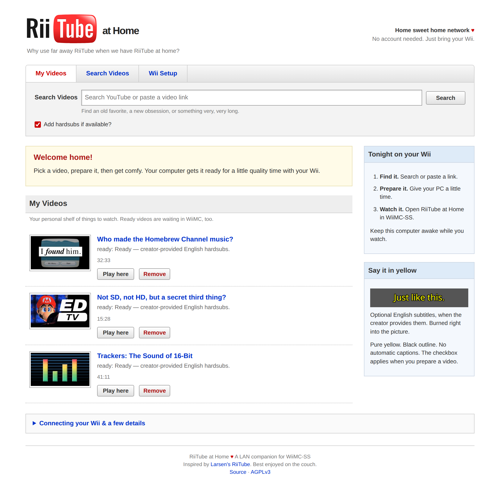

# RiiTube at Home

<picture>
  <source media="(max-width: 640px)" srcset="assets/screenshots/mobile.png">
  
</picture>

A LAN companion for WiiMC-SS. Search YouTube, prepare a video on your server,
and watch a complete, seekable copy on the Wii.

Designed for a RiiTube-like experience on your home network. Faster load times, videos downloaded to your machine indefinitely, and local transcoding.

- Search with thumbnails and browse multiple result pages in WiiMC.
- Queue videos and check preparation progress from WiiMC or a browser.
- Prepare H.264/AAC video for Wii playback in MKV, with MP4 for browsers.
- Optionally burn in creator-provided English subtitles; automatic captions are skipped.

## Run

Install Docker, then clone this repository:

```sh
git clone https://github.com/cmyksoda/RiiTube-at-Home.git
cd RiiTube-at-Home/docker
cp .env.example .env
# Set LAN_IP in .env to your server's LAN address.
docker compose up -d --build
```

Open `http://YOUR-LAN-IP:301` and use **Wii Setup** to add the RiiTube folder to
WiiMC's `onlinemedia.xml`. Back up the XML and keep your existing providers.
Relaunch WiiMC, search or select a video, and choose **Prepare for Wii**.
Playback becomes available when preparation finishes.

Videos are stored in a persistent Docker volume. The server downloads and
converts the whole video first, so longer videos need time and disk space.
Keep the server awake and use a trusted home LAN.

See [Docker setup](docker/README.md) and [Unraid setup](docker/UNRAID.md) for details.

## Native setup

Requires Python 3, FFmpeg, Node.js 22 or newer, and Noto Sans for subtitles.
Create `.venv`, install `requirements.txt`, and run `./start.sh`.
Set `RIIRIITUBE_URL` to the address your Wii can reach; the native default port is 8877.

Run tests with `python3 -m unittest discover -s tests -v` in the installed environment.

## Credits

- **RiiTube** by Larsenv, which inspired this project ([Larsenv/RiiTube](https://github.com/Larsenv/RiiTube))
- **yt-dlp** and its **yt-dlp-ejs** companion by the yt-dlp contributors, for searching YouTube and downloading videos
- **FFmpeg** by the FFmpeg developers, for converting videos and burning in subtitles
- **Node.js** by the Node.js contributors, the JavaScript runtime yt-dlp uses
- **Flask** by Pallets, **Waitress** by the Zope Foundation and contributors, and **Pillow** by Jeffrey "Alex" Clark and contributors, for the web server and thumbnails
- **Oswald** by The Oswald Project Authors, the font behind the "Rii" lettering in the logo
- **Noto Sans** by the Noto Project Authors, the font for burned-in subtitles
- The logo and icons adapt YouTube's 2006–2011 wordmark and 2005–2009 favicon, from Wikimedia Commons, which marks them PD-textlogo. YouTube's marks remain their owners' marks. See the [asset credits](assets/README.md).

## License

The original code in RiiTube at Home is free software under the [GNU Affero General Public License, version 3](LICENSE). Fonts and referenced artwork retain their own notices; see the [asset credits](assets/README.md). The Oswald font is under the SIL Open Font License 1.1, and its text is in [`static/fonts/OFL-Oswald.txt`](static/fonts/OFL-Oswald.txt).
